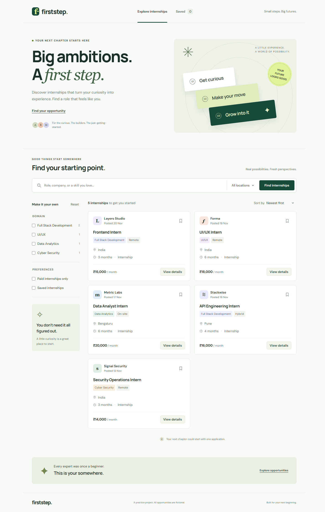
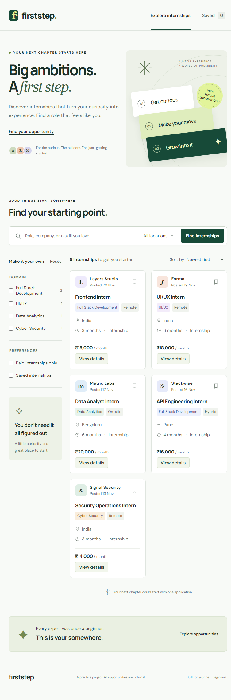
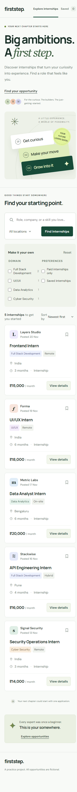

# Firststep — Responsive Internship Board

A framework-free internship board built for the EdVyro Responsive Internship Board task. Semantic HTML, responsive CSS, and vanilla JavaScript render the five supplied fictional internships, with search, domain and work-mode filters, sorting, saved roles, and accessible details dialogs.

**Live public preview:** https://firststep-internship-board.holloweucalyptus256.chatgpt.site

The preview is deployed and public. The public GitHub repository still requires a GitHub account connection. Source, screenshots, and a GitHub Pages workflow are ready to publish.

## Run locally

Requires Node.js 22 or later. No packages, API keys, environment variables, installation, or build step are needed.

```sh
npm start
```

Open **http://127.0.0.1:4173**. Use an HTTP server rather than opening `index.html` directly, because the app fetches its JSON data. The `dist/` directory is ready for any static host.

## Features

- Search roles, company names, locations, domains, and skills; matching ignores case and surrounding whitespace.
- Select multiple domains, combine with work mode and preferences, and remove individual domain filters.
- Sort by newest, highest stipend, or role title.
- Save and remove roles in local storage; view the saved list from the header. If storage is unavailable, saves work for the session.
- Inspect details in a native modal dialog, with Escape dismissal and focus restored to the opening button.
- Loading announcements, an empty state with reset, and a failed-fetch state with retry.
- No framework, dependencies, external images, or build pipeline. Optional Google Fonts fall back to system fonts.

## Screenshots

### Desktop · 1440px



### Tablet · 768px



### Mobile · 360px



## Page and data plan

The header provides exploration and saved-role navigation. The main content contains an introduction, labeled search form, domain and preference fieldsets, results status, reusable internship cards, and a details dialog. A footer identifies the records as fictional.

`dist/data/internships.json` preserves every original field in all five supplied records, including IDs INT-101–INT-105, titles, domains, modes, locations, skills, and openings. Added company, duration, monthly INR stipend, posted date, description, logo, and color fields are fictional presentation data. Dates are fixed sample dates, not live postings.

`board-core.js` validates the payload and filters/sorts without mutating the source. `app.js` handles rendering, events, fetch states, modal details, and local storage. Text inserted into HTML is escaped; colors and required record fields are validated. No personal application data is collected.

## Validation

```sh
npm test
npm run check
```

Six tests pass: source-field preservation, search, combined filters, saved/empty/paid results, sorting without mutation, and malformed/duplicate record rejection.

Real Chrome browser checks passed at **360px, 768px, and 1440px**, with no horizontal document overflow. Browser checks also cover live search, combined search and mode, no results, saved-role persistence after reload, initial dialog focus, keyboard Escape and focus return, failed network fetch and successful retry, and no runtime exceptions. Evidence: [browser-results.txt](docs/browser-results.txt). The screenshots above came from those checks.

To repeat browser checks, start the local server and a headless Chrome instance with remote debugging on port 9222, then run `node scripts/browser-check.mjs`. This uses Chrome’s DevTools protocol with Node’s native WebSocket and requires no browser automation package.

Accessibility features include a skip link, semantic landmarks, explicit form labels, fieldset legends, native checkboxes/selects, visible focus outlines, a polite result-count announcement, descriptive save/detail button names, `aria-pressed` bookmark state, native modal focus containment, Escape, focus restoration, and reduced-motion support. These checks are not a full screen-reader or WCAG audit.

## Completed task checklist

- [x] Plan the page structure and create reusable internship card data.
- [x] Build search and domain filters with empty and error states.
- [x] Add keyboard navigation, form labels, and responsive layouts.
- [x] Preserve the supplied seed IDs and original fields.
- [x] Document 360px, 768px, and desktop browser checks and screenshots.
- [ ] Publish the public GitHub repository and include its deployed preview URL.

The shared Full Stack product brief spans later tasks, including an API envelope, application validation, persistence, and duplicate prevention. This project implements the **Responsive Internship Board frontend task**; it does not implement the separately listed REST API task or accept applications. There are no database schema/seed commands or environment secrets for this static frontend.

## Source materials

- [Step-by-step task guide](https://edvyro.in/datasets/task-kits/full-stack-development-task-1.html)
- [Editable starter checklist](https://edvyro.in/datasets/task-kits/full-stack-development-task-1.md)
- [Full Stack product brief](https://edvyro.in/datasets/source-materials/task-source-library.html#full-stack)
- [Original internship seed](https://edvyro.in/datasets/source-materials/internship-records-sample.json)

The unmodified original seed is retained in `docs/sources/internship-records-sample.json` for review and data-preservation tests. Guides are available at the links above.

## Two-minute walkthrough script

1. **0:00–0:25** Introduce Firststep, the five supplied sample records, and the framework-free structure.
2. **0:25–0:55** Search “SQL”, select Hybrid, clear filters, and choose a domain.
3. **0:55–1:20** Save a role, open Saved, reload to demonstrate persistence, then inspect details and close with Escape.
4. **1:20–1:45** Search for a nonexistent role to show the empty state. Block the JSON request in browser tools, reload, then unblock and retry.
5. **1:45–2:00** Show the 360px, tablet, and desktop screenshots and the passing test results.

## GitHub and public preview

Create a public GitHub repository and push this folder. A GitHub Pages workflow is included in `.github/workflows/pages.yml`. In the repository’s **Settings → Pages**, select **GitHub Actions** as the build source. Pushes to `main` publish `dist/` automatically. Add the returned Pages URL to this README. Submit the repository URL as the single proof link; it includes source, screenshots, test evidence, and the preview link.
